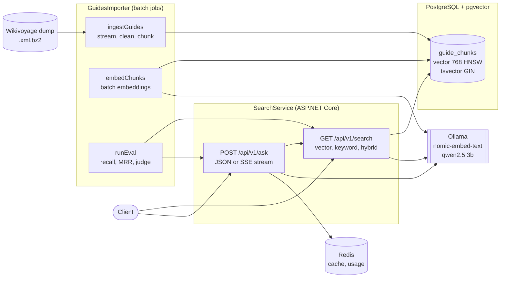

# Wayfinder

A question-answering API over public travel guides. Ask a travel question and get a short answer
that cites the Wikivoyage passages it came from (retrieval-augmented generation). Everything runs
locally and free: PostgreSQL with pgvector for search, and small open models on
[Ollama](https://ollama.com/) for embeddings and answers.

```http
POST /api/v1/ask
X-Api-Key: <your key>
Content-Type: application/json

{ "question": "When is the Chiang Mai Flower Festival held?" }
```

```json
{
  "answer": "The Chiang Mai Flower Festival is held in February [1].",
  "answered": true,
  "citations": [
    { "number": 1, "articleTitle": "Chiang Mai", "section": "Do",
      "sourceUrl": "https://en.wikivoyage.org/wiki/Chiang_Mai" }
  ],
  "metadata": { "promptVersion": "answer-prompt-v2", "model": "qwen2.5:3b",
                "inputTokens": 2984, "outputTokens": 14, "estimatedCostUsd": 0, "cached": false }
}
```

Questions the guides do not cover get a fixed reply, "I don't know based on the available
guides.", instead of a guess.

## What it does, in numbers

Measured on 17 November 2026 on a laptop (integrated GPU, 7 GB RAM); details in
[docs/EVALUATION.md](docs/EVALUATION.md) and [docs/LOADTEST.md](docs/LOADTEST.md).

| | |
|---|---|
| Corpus | 3,896 Wikivoyage articles (East and Southeast Asia), 33,192 chunks, 10.9 million tokens |
| Indexing | ingest 3 min 11 s; embed 2 h 49 min with `nomic-embed-text`, cost $0 |
| Retrieval, 64-question set (52 answerable) | hybrid recall@10 96% (article), recall@5 96% (section), MRR 0.897; recall@5 (section) is 88% for vector search alone and 69% for keyword search alone |
| Answers | 49 of 52 answerable questions answered, every answer with citations; 12 of 12 unanswerable questions refused; 80% judged supported by their sources (LLM judge, hand check pending) |
| Search latency | hybrid median 74 ms, p95 737 ms at 79 requests/s (40 concurrent users); levels off at about 125 requests/s, no errors up to 320 users |
| Answer latency | median 65 s, p95 82 s on the laptop's integrated GPU; cached answers median 7 ms, p95 23 ms |
| Cost per question | $0 (local models); token counts are recorded per request for a hosted model |

## Demo

Not deployed yet; run it locally as described below.

## Architecture



Two .NET 10 services share one database. **GuidesImporter** runs batch jobs: it streams the
Wikivoyage dump, turns wikitext into plain text, splits articles into 300 to 500 token chunks along
section boundaries, embeds them, and evaluates the API. **SearchService** answers questions: it
embeds the question, runs vector search (HNSW, cosine) and full-text search side by side, merges
the two rankings with reciprocal rank fusion, packs the best passages into the model's context
window, and asks the model to answer only from them and cite them by number.

The request path, the prompt-injection defence and the failure behaviour of each dependency are
described in [docs/ARCHITECTURE.md](docs/ARCHITECTURE.md).

## Run it locally

You need Docker, the .NET 10 SDK and about 3 GB of disk for the models.

1. Start PostgreSQL (with pgvector) and Redis:

   ```bash
   docker compose up -d
   ```

2. Install Ollama and pull the two models:

   ```bash
   winget install --id Ollama.Ollama --exact
   ```

   ```bash
   ollama pull nomic-embed-text
   ```

   ```bash
   ollama pull qwen2.5:3b
   ```

   On a laptop with an integrated AMD or Intel GPU, start the server with the GPU enabled
   (Ollama skips integrated GPUs by default). Here it and batches of 64 took embedding from 1.2 to
   3.2 chunks a second:

   ```bash
   OLLAMA_IGPU_ENABLE=1 ollama serve
   ```

3. Download the English Wikivoyage dump (about 130 MB) into `data/`, which git ignores:

   ```bash
   curl -o data/enwikivoyage-latest-pages-articles.xml.bz2 https://dumps.wikimedia.org/enwikivoyage/latest/enwikivoyage-latest-pages-articles.xml.bz2
   ```

4. Give both services the database connection string. Secrets live in user secrets (or
   environment variables such as `ConnectionStrings__Guides`), never in `appsettings.json`; the
   password is the local-only one from `docker-compose.yml`:

   ```bash
   dotnet user-secrets set "ConnectionStrings:Guides" "Host=localhost;Port=5432;Database=wayfinder;Username=wayfinder;Password=wayfinder_local_only" --project src/dotnet/guides/importer-guides/GuidesImporter
   ```

   ```bash
   dotnet user-secrets set "ConnectionStrings:Guides" "Host=localhost;Port=5432;Database=wayfinder;Username=wayfinder;Password=wayfinder_local_only" --project src/dotnet/guides/service-search/SearchService
   ```

   ```bash
   dotnet user-secrets set "ConnectionStrings:Redis" "localhost:6379" --project src/dotnet/guides/service-search/SearchService
   ```

5. Create an API key for `/api/v1/ask` (any string of 16 or more characters):

   ```bash
   dotnet user-secrets set "Auth:ApiKeys:0:Name" "local" --project src/dotnet/guides/service-search/SearchService
   ```

   ```bash
   dotnet user-secrets set "Auth:ApiKeys:0:Key" "<a long random string>" --project src/dotnet/guides/service-search/SearchService
   ```

6. Build the index. Each job is one command; run them in this order:

   ```bash
   dotnet run --project src/dotnet/guides/importer-guides/GuidesImporter -- migrateDatabase
   ```

   ```bash
   dotnet run --project src/dotnet/guides/importer-guides/GuidesImporter -- ingestGuides
   ```

   ```bash
   dotnet run --project src/dotnet/guides/importer-guides/GuidesImporter -- embedChunks
   ```

   Development ingests the East Asia and Southeast Asia regions; clear `Ingestion:Regions` to
   ingest everything. Both jobs skip work that is already done, so they can be stopped and rerun.
   Try a small run first with `EmbedChunks__MaxChunks=64`.

7. Start the API:

   ```bash
   dotnet run --project src/dotnet/guides/service-search/SearchService
   ```

   Then try `http://localhost:5099/api/v1/search?q=night+market+in+Taipei&mode=hybrid` and
   `http://localhost:5099/healthz/ready`. The OpenAPI document is at `/openapi/v1.json`.

### Endpoints

| Route | Auth | What it returns |
|---|---|---|
| `GET /api/v1/search?q=&mode=hybrid\|vector\|keyword&k=10` | none, rate limited per IP | ranked chunks with article, section, source URL and both ranks |
| `POST /api/v1/ask` | `X-Api-Key` | answer, citations, token counts, timings, cost |
| `POST /api/v1/ask/stream` | `X-Api-Key` | server-sent events: `sources`, `token`..., `done` |
| `GET /healthz/live`, `/healthz/ready` | none | liveness; readiness checks PostgreSQL |

Errors are problem-details JSON with a correlation id. If the chat model is down, `/ask` returns 503
with `Retry-After` and search keeps working; if the embedding model is down, hybrid search falls
back to keyword search and says so (`degraded: true`).

### Evaluate

With the API running, run the evaluation job. It sends every question in `eval/questions.json`
through the public API, scores retrieval in all three modes, judges the answers with the model,
and appends a section to `docs/EVALUATION.md`:

```bash
dotnet user-secrets set "Eval:ApiKey" "<the same key>" --project src/dotnet/guides/importer-guides/GuidesImporter
```

```bash
dotnet run --project src/dotnet/guides/importer-guides/GuidesImporter -- runEval
```

`Eval__EvaluateAnswers=false` scores retrieval only (about a minute instead of two hours).

### Tests

```bash
dotnet test src/dotnet/Wayfinder.sln
```

Integration tests start PostgreSQL in a container with Testcontainers, so Docker must be running.
The language models are faked in tests.

### Docker

Both images build with `src/dotnet` as the context:

```bash
docker build -f src/dotnet/guides/service-search/Dockerfile -t wayfinder/service-search src/dotnet
```

```bash
docker build -f src/dotnet/guides/importer-guides/Dockerfile -t wayfinder/importer-guides src/dotnet
```

The images run as a non-root user and read all settings from environment variables. CI workflows
are in `.github/workflows`, Helm values in `helm/`, and k6 load tests in `loadtest/`.

## Layout

| Path | Purpose |
|---|---|
| `src/dotnet/guides/service-search/SearchService` | HTTP API: search and ask |
| `src/dotnet/guides/importer-guides/GuidesImporter` | Batch jobs: migrate, ingest, embed, evaluate |
| `src/dotnet/guides/db-entities-guides/GuidesDbEntities` | EF Core context, entities, migrations |
| `src/dotnet/domains-shared/guides/DomainModels.Guides` | DTOs shared between services |
| `src/dotnet/connector-llm` | LLM interfaces (`Llm.Core`) and OpenAI-compatible clients (`Llm.Infrastructure`) |
| `eval/` | Question set and raw evaluation results |
| `loadtest/` | k6 scripts |
| `helm/` | Deployment values per service and environment |
| `docs/` | Build plan, architecture, evaluation and load-test results |

## Data and attribution

Guide content comes from [Wikivoyage](https://www.wikivoyage.org/), licensed
[CC BY-SA 4.0](https://creativecommons.org/licenses/by-sa/4.0/). Every stored article keeps the URL
of its source page, every search response carries the attribution, and every answer links back to
the articles it cites. The test fixtures under `GuidesImporter.Tests/Fixtures` are Wikivoyage
articles too; see the README there.
