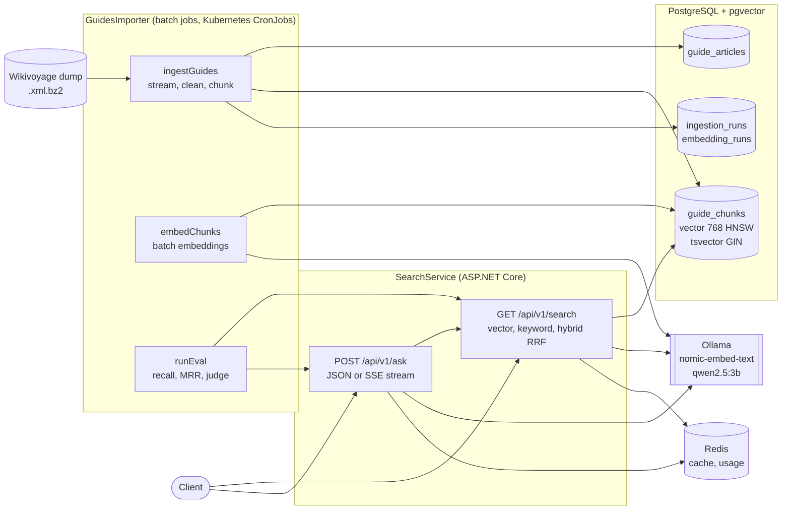

# Architecture

Wayfinder answers travel questions from Wikivoyage with citations. Two .NET services share one
PostgreSQL database: a batch importer that builds the index, and an HTTP API that searches it and
asks a language model to write the answer.

## Request path of a question

1. **Authenticate and limit.** `/api/v1/ask` needs an `X-Api-Key`; a fixed-window limiter allows
   a set number of questions per key per minute, and a daily token and cost cap (shared through
   Redis) switches answering off with a 503 when it is used up.
2. **Cache.** The normalised question plus k, prompt version and both model names is the cache key.
   A hit returns the stored answer without touching the database or the model.
3. **Retrieve (hybrid).** The question is embedded (`search_query:` prefix; the vector is cached),
   the HNSW index returns the 50 nearest chunks by cosine distance, full-text search returns the 50
   best `ts_rank_cd` matches (accents ignored, article-title matches boosted), and reciprocal rank
   fusion merges the two lists. Full-text search first ranks only the chunks that contain every
   query word; when fewer than 10 do, it ranks every chunk that contains any of them. Ranking cost
   grows with the number of matching chunks, and a common word matches thousands, so the first
   pass quadrupled search throughput (see [LOADTEST.md](LOADTEST.md)). If the embedding model is down, retrieval degrades to keyword search
   and says so in the response.
4. **Budget.** Sources are taken in rank order while they fit the model's context window, after
   room for the answer, the fixed prompt and a safety margin.
5. **Generate.** The prompt (`answer-prompt-v2`) keeps the rules in the system message and every
   retrieved passage inside a delimited `<source>` element in the user message; tag-like text in a
   passage is neutralised so it cannot escape its element. A fixed reminder after the question
   repeats the citation rule with an example (the small local model ignored it otherwise). The
   model must cite `[n]` or reply with the fixed "I don't know" sentence.
6. **Map citations.** `[n]` numbers are mapped back to chunks and their Wikivoyage URLs; numbers that
   match no source are dropped and counted.
7. **Report.** The response carries tokens in and out, retrieval and generation times, the prompt
   version and the estimated cost. Traces and metrics go to OpenTelemetry.

## Indexing

- **ingestGuides** streams the dump (one `<page>` in memory at a time), keeps the articles under the
  configured regions of the `IsPartOf` hierarchy, turns wikitext into plain text (listing templates
  become one line with name, description, hours and price), and chunks it: sections are kept
  together, chunks are 300 to 500 tokens, a full chunk breaks at a line start where it can, and
  boundaries never fall inside a sentence. An article is rewritten only when its text, title or
  processing settings changed; unchanged chunks keep their embeddings.
- **embedChunks** embeds chunks with no embedding, a stale one (content hash changed) or one from
  another model, in batches that are saved as they finish, so the job can stop and resume.

## Failure behaviour

| Failure | `/api/v1/search` | `/api/v1/ask` |
|---|---|---|
| Embedding model down | hybrid: keyword results, `degraded: true`; vector: 503 | answers from keyword retrieval |
| Chat model down | unaffected | 503 problem details with `Retry-After` |
| Redis down | cache misses only | cache misses; cost cap counts per instance |
| PostgreSQL down | error problem details, readiness check fails | same |
| Slow dependency | per-attempt timeouts, retries with backoff, circuit breaker; request timeout 504 | same |

Every error is a problem-details JSON body with a correlation id and no stack trace.

## Code layout

Controllers call application services; services call database services (repositories); EF Core
queries live only in `Database/Services`. Settings are bound to validated options classes at
startup. Every I/O method is async and takes the request's cancellation token, so a timeout or a
disconnected client cancels the database query and the model call.
